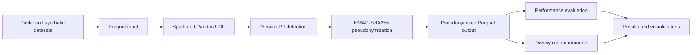
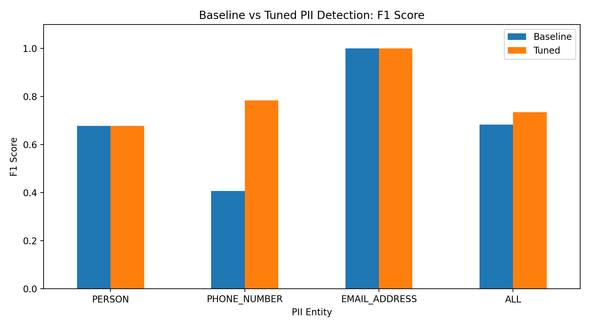
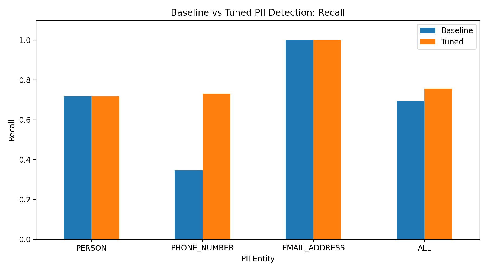
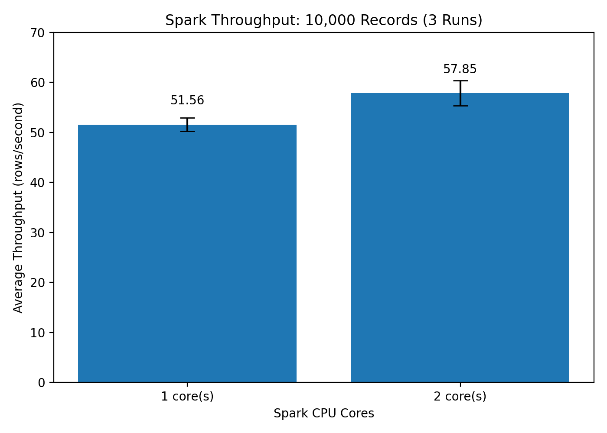
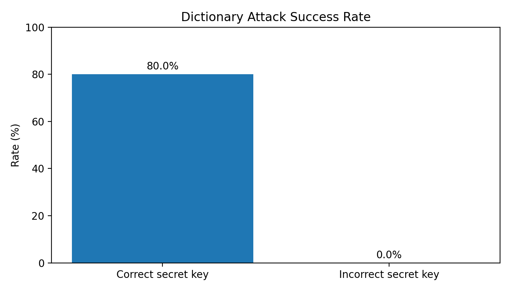
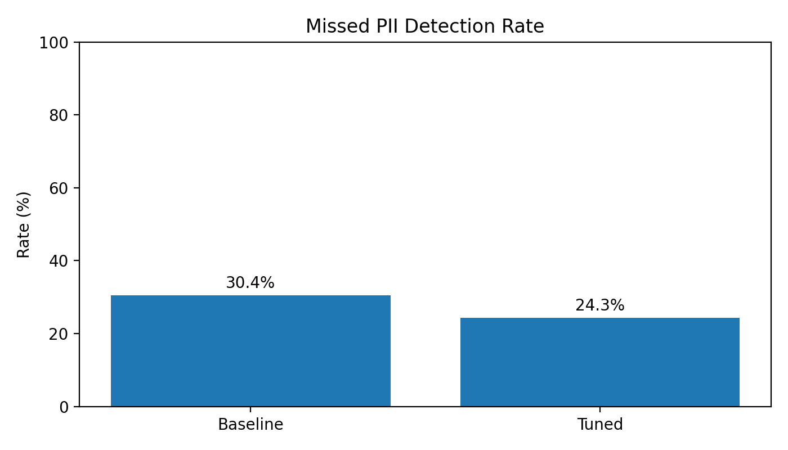
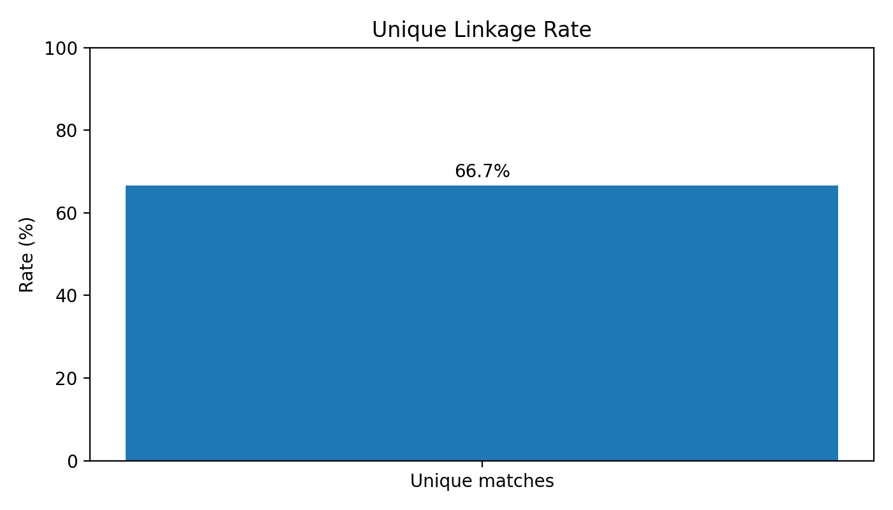

# PII Detection and Pseudonymization Pipeline

A privacy-focused big data pipeline that detects personally identifiable information (PII) in customer-support text using **Microsoft Presidio**, replaces detected information with **HMAC-based pseudonyms**, and evaluates detection accuracy, Spark processing throughput, and residual re-identification risks.

**Project areas:** Big Data Systems and Responsible AI Engineering.

## 1. Project Objectives

- Detect personal information such as names, email addresses, and phone numbers.
- Process text datasets using Apache Spark and Pandas UDFs.
- Replace detected PII with consistent, keyed pseudonyms.
- Evaluate detection performance using precision, recall, and F1-score.
- Measure processing throughput using different Spark core configurations.
- Investigate privacy risks through dictionary attacks, missed-PII analysis, and record-linkage experiments.

## 2. Architecture



## 3. Technologies Used

| Technology | Purpose |
|---|---|
| Python | Pipeline implementation |
| Apache Spark / PySpark | Distributed data processing |
| Pandas | Data manipulation and evaluation |
| Microsoft Presidio | PII detection |
| spaCy | NLP support |
| HMAC-SHA256 | Deterministic pseudonym generation |
| Parquet | Dataset storage |
| Pytest | Automated testing |
| Matplotlib | Results visualization |

## 4. Setup

### Option 1: Docker

```bash
export PSEUDO_SECRET="replace-with-a-strong-random-secret"
docker compose up --build pipeline
```

### Option 2: Local environment

Requires Python with compatible project dependencies and Java 17 for Spark.

```bash
python -m venv .venv
source .venv/bin/activate
pip install -r requirements.txt
python -m spacy download en_core_web_lg
```

Configure the environment:

```bash
export PYTHONPATH=src
export PSEUDO_SECRET="replace-with-a-strong-random-secret"
```

Run the project workflow:

```bash
bash scripts/run_all.sh
```

On Windows, use the corresponding environment-variable commands or run the workflow in a compatible shell.

**Security requirement:** `PSEUDO_SECRET` must be explicitly configured. The pseudonymization pipeline does not silently fall back to a default key.

## 5. Project Structure

| Path | Purpose |
|---|---|
| `src/pii_pipeline/` | Detection, Spark processing, evaluation, and re-identification experiments |
| `scripts/` | Dataset preparation and execution scripts |
| `data/raw/` | Input datasets |
| `data/processed/` | Processed Parquet datasets |
| `tests/` | Automated tests |
| `results/` | Experimental metrics and visualizations |
| `notebooks/` | Analysis notebooks |
| `docs/report/` | Technical report |
| `docs/MODEL_CARD.md` | Model and data documentation |
| `docs/demo/` | Demonstration resources |

## 6. Experimental Results

### 6.1 PII Detection Performance

Detection was evaluated on 1,000 English documents containing 654 annotated PII entities.

| Metric | Baseline | Tuned |
|---|---:|---:|
| Overall F1-score | 0.6837 | 0.7344 |
| Email F1-score | 1.0000 | 1.0000 |
| Person F1-score | 0.6776 | 0.6776 |
| Phone number F1-score | 0.4068 | 0.7835 |
| Missed annotated entities | 199 | 159 |
| Missed entity percentage | 30.43% | 24.31% |

The tuned detector improved overall F1-score, with the largest improvement in phone-number detection.

The number of missed annotated entities decreased by **40**, demonstrating an improvement in detection coverage on the evaluation dataset.

**Detection visualizations:**





### 6.2 Spark Throughput Benchmark

The pipeline was benchmarked on 10,000 records using one and two Spark cores, with three runs for each configuration.

| Configuration | Average throughput |
|---|---:|
| 1 Spark core | 51.56 rows/second |
| 2 Spark cores | 57.85 rows/second |

Using two cores improved average throughput by approximately **12.2%**, equivalent to a **1.12× speedup**.

The observed scaling was not linear, showing that additional cores do not necessarily produce proportional performance gains.



These results describe the tested environment and workload, not guaranteed performance on larger clusters.

## 7. Pseudonymization

Detected PII is replaced with deterministic pseudonyms generated using keyed HMAC-SHA256.

For example:

**Original:**

```text
Contact alice@example.com for assistance.
```

**Pseudonymized:**

```text
Contact <EMAIL_ADDRESS_2341f01c55> for assistance.
```

The same PII value produces the same pseudonym when the entity type and secret key remain unchanged.

This supports consistent references across records while reducing direct exposure of detected personal information.

The pipeline processes replacements from right to left to avoid shifting text positions during replacement.

The pseudonyms use truncated HMAC outputs, so collisions remain theoretically possible. Pseudonymization also preserves linkability and should not be treated as complete anonymization.

## 8. Re-identification and Privacy Risk Experiments

Three privacy-risk experiments were conducted using synthetic examples and evaluation results.

### 8.1 Dictionary Attack

| Scenario | Recovered | Recovery rate |
|---|---:|---:|
| Correct secret key | 4 of 5 | 80% |
| Incorrect secret key | 0 of 5 | 0% |

The experiment demonstrates that an attacker with the correct secret key and suitable candidate values may reproduce pseudonyms and identify matching inputs.

It does not demonstrate cryptographic cracking of HMAC.



### 8.2 Missed-PII Analysis

| Detector | Missed entities | Miss rate |
|---|---:|---:|
| Baseline | 199 / 654 | 30.43% |
| Tuned | 159 / 654 | 24.31% |

Undetected PII can remain visible in the processed text.

The tuned detector reduced this risk indicator, but missed-entity percentages are not equivalent to measured real-world data leakage rates.



### 8.3 Record-Linkage Attack

A constructed experiment compared three pseudonymized records with auxiliary information.

Two records produced unique matches, while one remained ambiguous.

**Unique-match rate: 66.67% (2 of 3 records).**

This illustrates how auxiliary attributes may enable record linkage even after direct identifiers have been replaced.

The small synthetic experiment is illustrative and does not estimate real-world re-identification probability.



The percentages from these three experiments measure different outcomes and should not be directly compared as equivalent attack-success rates.

## 9. Testing and Validation

The project was validated using:

- **15 passing automated tests** covering detection, scoring, pseudonymization, and privacy-risk functions.
- An end-to-end Spark test using five synthetic customer-support records.
- Verification that the five input records were preserved in the output.
- Verification that all test email addresses were replaced.
- Verification that repeated email addresses received identical pseudonyms.
- Verification that different test email addresses received distinct pseudonyms.

Run the automated tests with the required environment variables configured:

```bash
python -m pytest tests/ -q
```

## 10. Responsible AI and Ethical Considerations

The project uses public and synthetic datasets for experimentation.

Important privacy considerations include:

- **Detection errors:** Undetected PII may remain in output text.
- **Pseudonym linkability:** Repeated identifiers receive consistent pseudonyms, allowing records to be linked.
- **Secret-key protection:** Exposure of the key can enable candidate-based attacks.
- **Auxiliary information:** Other attributes may allow individuals or records to be linked.
- **HMAC truncation:** Shortened pseudonyms introduce a theoretical collision risk.
- **Data minimization:** Only necessary data should be processed and retained.

Secrets must not be committed to GitHub. Real personal information should not be introduced into test datasets or published results.

## 11. Limitations

- Detection accuracy depends on the types of PII and the evaluation dataset.
- Some names, phone numbers, and other identifiers may not be detected.
- Deterministic pseudonyms preserve relationships between repeated values.
- Throughput results were measured on a limited local Spark configuration.
- The re-identification experiments use small synthetic scenarios.
- Pseudonymization does not guarantee anonymity or eliminate all privacy risks.

## 12. Conclusion

The project demonstrates an end-to-end PII detection and pseudonymization workflow using Apache Spark, Microsoft Presidio, and HMAC-SHA256.

Tuning improved detection F1-score from **0.6837 to 0.7344**, while the two-core Spark configuration achieved **12.2% higher average throughput** than the one-core configuration.

The privacy experiments also show that pseudonymization alone is insufficient to eliminate disclosure and re-identification risks.

The overall system combines scalable text processing with measurable privacy evaluation, highlighting the importance of both engineering performance and responsible data handling.