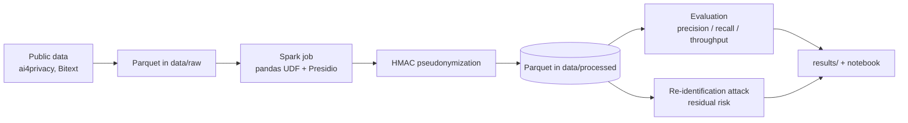

# PII Detection and Pseudonymization Pipeline

Spark pipeline that detects names, phone numbers and emails in customer-support logs (Microsoft Presidio),
replaces them with keyed pseudonyms, and measures **precision/recall/throughput** plus **re-identification residual risk**.

**Components:** Big data (Spark distributed processing, throughput scaling) + Responsible AI (privacy, re-identification testing).

## Architecture


## Setup
```bash
# Option 1: Docker
export PSEUDO_SECRET="pick-a-long-random-string"
docker compose up --build pipeline

# Option 2: local (needs Java 17)
python -m venv .venv && source .venv/bin/activate
pip install -r requirements.txt && python -m spacy download en_core_web_lg
export PYTHONPATH=src PSEUDO_SECRET=...
bash scripts/run_all.sh
```

## Layout
| Path | Purpose |
|---|---|
| `src/pii_pipeline/` | Spark job, evaluation, re-identification test |
| `scripts/` | data download, end-to-end run |
| `notebooks/` | results notebook |
| `docs/report/` | 3-5 page technical report |
| `docs/MODEL_CARD.md` | model/data card |
| `docs/demo/` | 3-minute demo video link |

## Results
_To fill: metrics table, throughput chart, re-identification report._

## Data & ethics
Only public/synthetic datasets. No real personal data. Secrets are never committed (`.env`, `PSEUDO_SECRET`).
